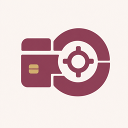
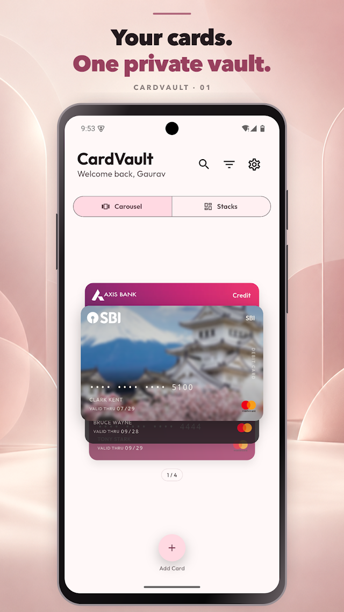
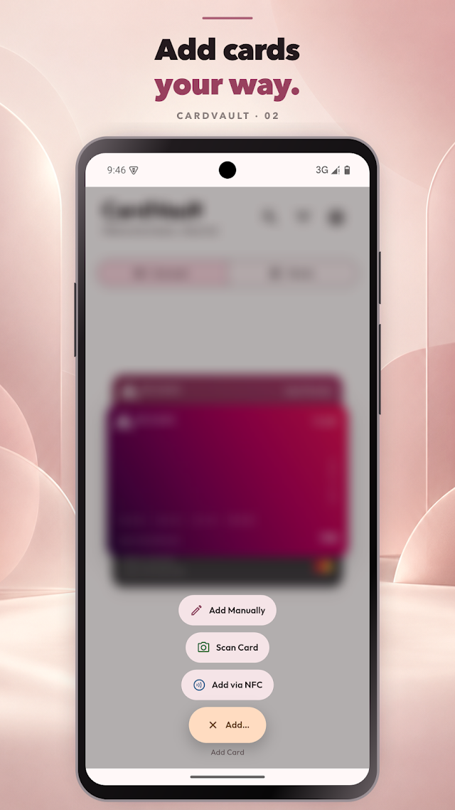
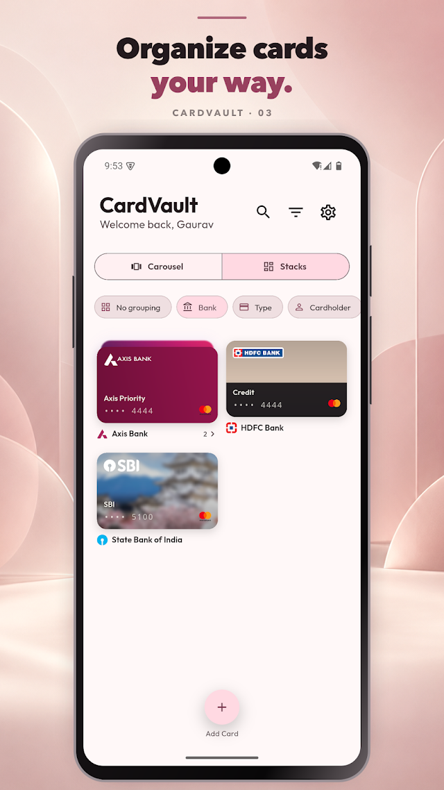
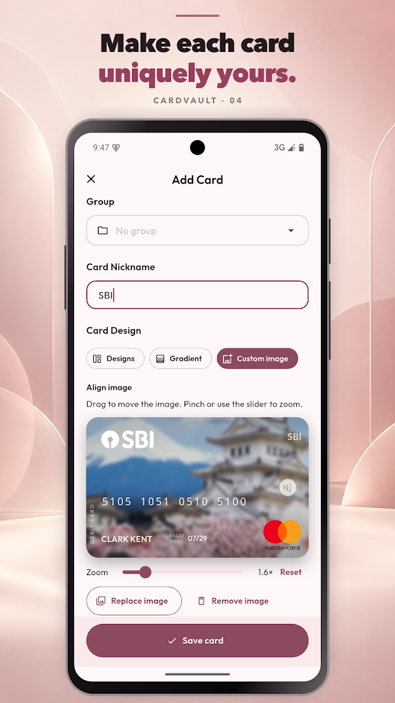
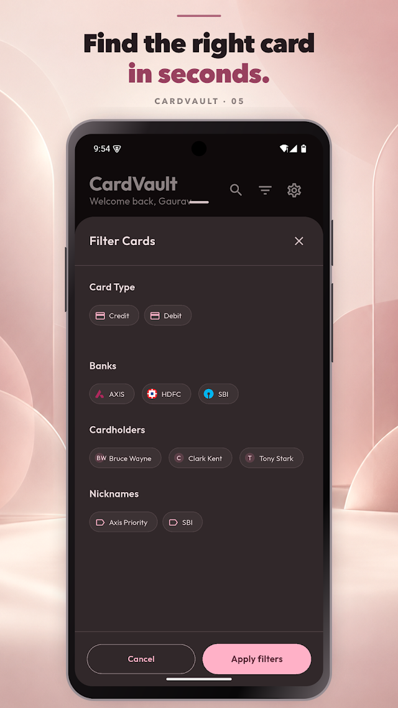
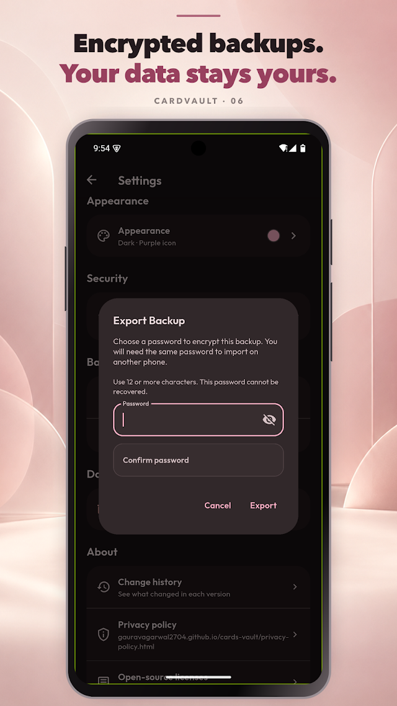
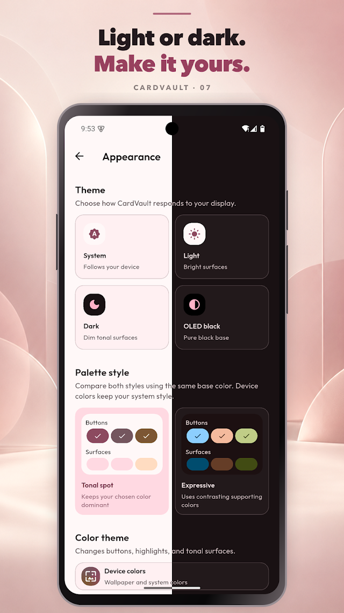
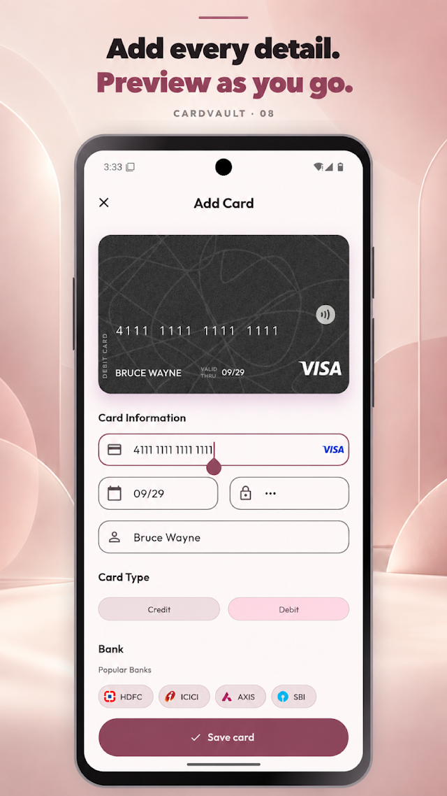

<p align="center">
  
</p>

<h1 align="center">CardVault</h1>

<p align="center">
  <strong>Your cards. One private vault.</strong><br />
  Organize debit and credit cards in a personal, open-source, offline wallet built with Flutter.
</p>

<p align="center">
  <a href="https://play.google.com/store/apps/details?id=com.cardswallet.cards_vault"><strong>Get it on Google Play</strong></a>
  &nbsp;·&nbsp;
  <a href="https://gauravagarwal2704.github.io/cards-vault/">App website</a>
  &nbsp;·&nbsp;
  <a href="#features">Features</a>
  &nbsp;·&nbsp;
  <a href="#security-and-privacy">Security</a>
  &nbsp;·&nbsp;
  <a href="#known-issues-and-limitations">Known issues</a>
  &nbsp;·&nbsp;
  <a href="#development">Build from source</a>
  &nbsp;·&nbsp;
  <a href="https://gauravagarwal2704.github.io/cards-vault/privacy-policy.html">Privacy policy</a>
</p>

---

CardVault brings your card details, designs, and notes together on your device. Add cards manually, scan them with your camera, or read supported contactless cards over NFC. Browse your collection, find the right card quickly, and control when sensitive details are revealed.

**Completely offline. No account required. No ads. No analytics.** Your saved wallet and Android card scanning stay on your device; sharing, support emails, and optional Google Play purchases use the external service you choose.

## Screenshots

Screenshots from the [Google Play listing](https://play.google.com/store/apps/details?id=com.cardswallet.cards_vault). Tap an image to view it at full size.

<table>
  <tr>
    <td align="center" width="25%"><a href="docs/images/wallet.png"></a><br /><strong>Your private vault</strong></td>
    <td align="center" width="25%"><a href="docs/images/add-card.png"></a><br /><strong>Three ways to add cards</strong></td>
    <td align="center" width="25%"><a href="docs/images/organize.png"></a><br /><strong>Organized card stacks</strong></td>
    <td align="center" width="25%"><a href="docs/images/customize.png"></a><br /><strong>Personal card designs</strong></td>
  </tr>
  <tr>
    <td align="center"><a href="docs/images/filters.png"></a><br /><strong>Search and filters</strong></td>
    <td align="center"><a href="docs/images/encrypted-backup.png"></a><br /><strong>Encrypted backups</strong></td>
    <td align="center"><a href="docs/images/appearance.png"></a><br /><strong>Make it yours</strong></td>
    <td align="center"><a href="docs/images/card-editor.png"></a><br /><strong>Live card previews</strong></td>
  </tr>
</table>

## Features

### Add and manage cards

- **Manual entry, camera scanning, and NFC reading** — choose the method that suits your card. Android camera recognition runs on the device.
- **Debit and credit card organization** — save card details, bank, nickname, account information, UPI ID, notes, and photo attachments.
- **Multiple card networks** — recognition for Visa, Mastercard, American Express, Discover, JCB, UnionPay, RuPay, Maestro, and Diners Club. NFC compatibility depends on the card and issuer.
- **Easy card management** — view, edit, delete, copy protected fields, and share selected card information.

### Find and personalize your cards

- **Carousel and stacked views** — browse cards individually or group them by bank, type, or cardholder.
- **Search and filters** — find cards by bank, cardholder, nickname, or last four digits; filter by category and custom group.
- **Custom card designs** — choose built-in artwork, create gradients, or use your own images with positioning, zoom, blur, and overlay visibility controls.
- **Appearance settings** — system, light, dark, and OLED black modes; color presets, custom colors, supported Android device colors, and alternate app icons.
- **Android home-screen widgets** — choose cards for grid, vertical, or compact widgets, with separate selections and preview settings.

### Keep control of your data

- **Encrypted backup and restore** — export your wallet or a single card to a password-protected `.cwbak` file, including associated images and groups; restore with merge or replace options.
- **Local data management** — delete individual cards or all saved cards from Settings.
- **Support and diagnostics** — send feedback and optionally attach redacted diagnostics; read release notes inside the app.
- **Optional Supporter Stars** — support development through Google Play without restricting or unlocking functional features.

## Security and privacy

### Implemented protections

| Protection | How it works |
| --- | --- |
| **Encrypted card fields** | Sensitive fields, including card number, expiry, cardholder name, security code, and account identifiers, use **AES-256-GCM** with a fresh secure random IV for each encryption. |
| **Platform secure storage** | A randomly generated 256-bit master key and structured card records are held using `flutter_secure_storage`: encrypted shared preferences backed by Android Keystore on Android, and Keychain on iOS. Sensitive fields are encrypted before records are saved. |
| **Encrypted attachments** | Card photo attachments are AES-GCM encrypted in private app storage. Custom background images use separate private storage; see the limits below. |
| **Device authentication** | App lock is enabled by default for new installations. Protected actions such as revealing, copying, editing, sharing sensitive details, and exporting use device authentication through biometrics or the device credential. CardVault does not receive biometric data or store your device PIN. |
| **Masked details** | Card numbers are masked in wallet views. Card number, expiry, and security code fields remain hidden in the details screen until revealed through the authentication policy. |
| **Automatic locking and hiding** | App lock uses a two-minute grace period after leaving the app. Revealed card number, expiry, and security code fields hide after 30 seconds. NFC scan state clears after five minutes. Successful protected-action authentication can be reused for five minutes. |
| **Android capture protection** | `FLAG_SECURE` is enabled at startup to block screenshots and screen recording of protected app windows. Launcher widgets are outside this protection. |
| **Password-encrypted exports** | Current backups use AES-GCM and **Argon2id** password derivation with a random salt: 64 MiB memory, three iterations, four lanes, and a 256-bit derived key. Export passwords require at least 12 characters. Older backup formats remain importable. |
| **Validated backup imports** | Imports validate archive paths, sizes, entry counts, and image limits. Records are validated and re-encrypted before replacing wallet data, with rollback support if applying an import fails. |
| **Offline Android release** | The production manifest removes Internet and network-state permissions, disables cleartext traffic and Android system backup, and removes unused microphone and background-service permissions. Camera recognition uses bundled local models. |
| **Private diagnostics** | Local diagnostics are bounded, encrypted, designed to redact sensitive fields, and expire after 72 hours. Attaching diagnostics to feedback requires an explicit choice. Debug logging sanitizes sensitive values. |
| **Dependency maintenance** | Application dependencies are pinned in the lockfile; Dependabot is configured for weekly Flutter and Android dependency updates. See [dependency maintenance](docs/dependency-maintenance.md) and the [November dependency review](docs/dependency-updates-2026-11-19.md). |

### Security boundaries

- **Custom background images** are stored as image files in private app storage, without the additional field encryption used for card records and attachments. Any details embedded in an image remain visible when that image is displayed.
- **Home-screen widgets** display cached previews outside app lock and can appear in launcher screenshots. Selected previews can contain cardholder name, bank, nickname, last four digits, network, and artwork. Full card numbers, expiry dates, security codes, and notes are not copied from saved fields into widget previews; custom artwork may itself contain sensitive text.
- **Copying and sharing** hands selected information to the system clipboard or another app. Exported files and information passed to other apps are then under your control and the receiving app's control.
- **Backup passwords cannot be recovered.** Keep your password and exported backup somewhere safe; CardVault has no server account or cloud wallet recovery.

For data handling, retention, deletion, and contact information, read the [privacy policy](https://gauravagarwal2704.github.io/cards-vault/privacy-policy.html). These are descriptions of implemented controls, not a claim of PCI DSS certification or an independent security audit.

<details>
<summary><strong>Encryption, key management, and storage details</strong></summary>

| Component | Current implementation |
| --- | --- |
| Master key | 32 secure random bytes (256 bits), generated on first use and stored under `encryption_master_key` in platform secure storage; cached for the running process. |
| Field encryption | AES-256-GCM with a fresh, secure random **16-byte IV** for each nonempty value. The serialized field format is `base64(IV):base64(authenticated ciphertext)`. GCM authentication rejects modified ciphertext. |
| Encrypted model fields | Card number, expiry, cardholder name, CVV/CVC when supplied, account number, IFSC code, and UPI ID. Display metadata such as last four digits and card type remains available to the UI; complete records are stored in secure storage. |
| Record storage | An index (`saved_cards_list`) plus UUID-addressed `card_<id>` records. Sensitive fields retain their own encryption inside platform-protected record storage. Operations are serialized to avoid partially updated wallet reads. |
| Android key and record storage | `flutter_secure_storage` with encrypted shared preferences backed by Android Keystore. Card storage uses `resetOnError: false`, so a transient key-store error is surfaced instead of automatically resetting the wallet. |
| iOS key and record storage | Keychain with `first_unlock` accessibility. This describes the source configuration, not a claim of hardware Secure Enclave key storage or Android-equivalent protection on every platform. |
| Photo attachments | Base64-encoded image bytes are encrypted with the same AES-GCM service and saved as `.enc` files under private app storage. Custom card background images are a separate, unencrypted-at-the-field-level exception described above. |
| Current portable backups | Format `3.0` (`.cwbak`) encrypts a ZIP bundle containing card/group metadata and optionally images. A random 16-byte salt and **Argon2id v1.3** derive a 32-byte encryption key using 64 MiB memory, three iterations, and four lanes; payload encryption uses AES-GCM with a fresh 16-byte IV. KDF parameters accompany the encrypted export. |
| Legacy backup imports | Older JSON formats `1.0`/`2.0` remain supported. Password-encrypted backups without KDF metadata use the legacy PBKDF2-HMAC-SHA-256 derivation (100,000 iterations); the earliest device-key format requires the original key. New exports use Argon2id. |
| Restore protection | Imported records are decrypted, validated, and re-encrypted with the receiving device's master key. Archive limits and path containment checks apply before files are written; applying an import supports rollback. |

Encryption at rest does not mean plaintext never exists: scanning, editing, displaying, copying, and sharing require decrypted values in process memory. The NFC state timer clears the scanned-card reference; it is not a guarantee that every plaintext byte has been securely erased from managed memory. Device authentication is coordinated at protected UI actions; the encryption service itself does not prompt on every decryption.

The app's five-minute protected-action authentication reuse window is separate from the 30-second visibility timer and two-minute background app-lock grace period. The operating system handles biometric or device-credential authentication; the current flow does not use a separate app-managed PIN, even though older documents describe one.

Source: [encryption service](lib/services/encryption_service.dart), [encrypted card model](lib/models/card_data.dart), [secure card storage](lib/services/secure_card_storage.dart), [attachment storage](lib/services/card_attachment_storage.dart), [backup cryptography](lib/services/backup_crypto.dart), and [authentication coordinator](lib/services/auth_service.dart).

</details>

## Getting started

1. Install [CardVault from Google Play](https://play.google.com/store/apps/details?id=com.cardswallet.cards_vault).
2. Set up your device lock and review CardVault's security settings.
3. Tap **Add Card** and choose manual entry, camera scanning, or NFC.
4. Review the details, choose a design or group, and save the card.
5. Use search, filters, or stacks to find cards. Authenticate when revealing protected fields.
6. Create a password-encrypted backup from Settings if you want a portable copy of your wallet.

### Platform support

| Platform | Availability and requirements |
| --- | --- |
| **Android** | Published on Google Play. Requires **Android 8.0 / API 26 or later**. Camera scanning and manual entry work without NFC hardware. NFC reading requires an NFC-capable device, NFC enabled, and a compatible contactless EMV card. |
| **iOS** | Source project included; no App Store release is linked here. Payment-card NFC reading is not supported by this app on iOS. Android-specific scanner, capture protection, and widget behavior do not apply. |
| **Other platforms** | Flutter platform scaffolding is present; this README does not claim feature parity or a supported release. |

### NFC compatibility and troubleshooting

NFC reading supports multiple payment applications (AIDs), known-AID fallback, and ISO 7816-4 command handling for domestic and international cards. See the expandable EMV reference below for command-format exceptions. It reads the card number and expiry, plus the cardholder name when exposed by the card. The printed CVV/CVC and your PIN cannot be obtained through this NFC reading flow.

If a card does not scan, enable NFC, remove thick cases, and hold the card steady near the phone's NFC antenna. Try a different position or retry the scan. A contact EMV chip alone is insufficient: the card must support contactless reading. Some issuers restrict the available data; use the camera or manual entry when needed. CardVault organizes card information and does not make contactless payments.

## Known issues and limitations

| Limitation | What to expect / workaround |
| --- | --- |
| **Payment-card NFC on iOS** | This app rejects iOS NFC card reads. Use manual entry or the camera flow where supported; Android's native scanner is platform-specific. |
| **Card and issuer compatibility** | An EMV chip alone does not guarantee contactless support. Some cards expose limited data or reject the reader's commands, including some domestic-only and international cards. Try another add method if fallback AIDs do not work. |
| **Range and read speed** | NFC requires very close contact, typically within a few centimetres (often under 4 cm). Reads can take several seconds; the original 3–10-second estimate is device/card dependent, not a guarantee. Keep one card steady at the antenna. |
| **Missing card fields** | The cardholder name and other fields may be absent. Printed CVV/CVC and PIN are not read by the NFC flow. Track 2 equivalent data can be parsed for number/expiry; this is not access to every field on the physical card. |
| **Recognition and network labels** | Camera OCR and card-prefix detection can be incomplete or wrong. Review extracted details before saving; a recognized network is not proof that a card is valid or that NFC reading will succeed. |
| **No payment or transaction service** | CardVault does not make contactless payments, verify a card with its issuer, or fetch bank transaction history. |
| **No automatic sync or recovery** | Wallet data is local, Android system backup is disabled, and there is no cloud account. Losing app data or its encryption key can make local records unreadable. Keep a portable encrypted backup and its password separately. |
| **Capture and device boundaries** | Android app-window protection does not cover launcher widgets, external receiving apps, or an external camera. iOS capture protection and root/jailbreak detection are not implemented by the current security service. |
| **Information leaving the app** | Clipboard contents, shared details, and exported files leave CardVault's UI protections. The current copy action does not schedule automatic clipboard clearing. See the security boundaries above for custom artwork and widget previews. |

For reproducible defects and current reports, see [GitHub Issues](https://github.com/gauravagarwal2704/cards-vault/issues). The table describes known implementation limits, not a guarantee that all reported bugs are listed here.

<details>
<summary><strong>Troubleshooting and error handling</strong></summary>

| Symptom | Checks and recovery |
| --- | --- |
| NFC unavailable | Confirm the phone has NFC hardware. Manual entry and camera scanning do not require NFC. |
| NFC disabled | Enable NFC in Android Settings (often **Connected devices → Connection preferences → NFC**; names vary by device), then retry. |
| Card removed / connection lost | Hold the card steady against the NFC antenna, remove thick cases, and keep other cards away. Reposition and retry if necessary. |
| Scan timeout | Current NFC polling uses a **60-second timeout**; the previous README's 30-second value is obsolete. Retry with the card correctly positioned. Individual transceive operations attempt up to three times after exceptions, with short increasing delays. |
| Unsupported card | Access badges and nonpayment tags are not supported payment cards. For a payment card that does not expose readable data, use camera scanning or manual entry. |
| PPSE or application selection fails | The reader tries multiple discovered AIDs and known fallback AIDs. Some issuers still reject all available applications; retries cannot guarantee compatibility. |
| `6700` / wrong length, or GPO rejected | Command length, PDOL requirements, and expected-length (`Le`) handling vary across cards. Consult the NFC guides below; capture only redacted diagnostics for a bug report. |
| Camera fails or text is incomplete | Grant camera permission when prompted, use even lighting, avoid glare, and review/correct the scanned fields. Manual entry remains available. |
| Protected details cannot be revealed | Set up a device PIN, pattern, password, or biometrics. Retry after device authentication lockout ends. Authentication cancellation or failure should leave details protected. |
| Wrong backup password / damaged export | Use the password chosen for that export. Wrong passwords and corrupted ciphertext fail decryption; there is no password reset or server recovery. Oversized or malformed archives are also rejected. |
| App crash or development build failure | Record the app/Android version and reproduction steps. For a local build, inspect `flutter logs`, run `flutter doctor`, and verify that the SDK satisfies `pubspec.yaml`. If stale build output is suspected, run `flutter clean`, then `flutter pub get`, and rebuild. Never include card data or raw NFC responses in public logs. |

Detailed guides: [NFC troubleshooting](docs/NFC_TROUBLESHOOTING_GUIDE.md), [quick fixes](docs/QUICK_FIX_REFERENCE.md), and [RuPay/domestic-card compatibility](docs/RUPAY_DOMESTIC_FIX.md). These guides include historical examples; current source and the limits above take precedence.

</details>

## Development

### App showcase website

The static GitHub Pages showcase lives in [`docs/index.html`](docs/index.html). Preview it with `python3 -m http.server 8080 --directory docs`, then open <http://localhost:8080>. See the [publishing guide](docs/github-pages.md) for GitHub Pages setup.

### Prerequisites

- Flutter SDK containing **Dart 3.13 or later, below 4.0**, as required by `pubspec.yaml`.
- Android SDK and **JDK 17** for Android builds.
- An Android device for testing camera and NFC hardware behavior.

```bash
git clone https://github.com/gauravagarwal2704/cards-vault.git
cd cards-vault
flutter pub get
flutter run
```

Run the standard checks:

```bash
flutter analyze
flutter test
```

For a release build, configure your own signing credentials in `android/key.properties` before running `flutter build appbundle --release`. Keep signing keys and credentials out of Git. Debug/profile builds permit networking for Flutter tooling; the Android release manifest removes that permission.

<details>
<summary><strong>Android configuration and key dependencies</strong></summary>

The Android app targets a minimum of **API 26** in [the Gradle configuration](android/app/build.gradle), replacing the original README's API 19 requirement. NFC hardware is optional so devices without it can still install the app:

```xml
<uses-permission android:name="android.permission.NFC" />
<uses-feature android:name="android.hardware.nfc" android:required="false" />
<uses-permission android:name="android.permission.CAMERA" />
<uses-feature android:name="android.hardware.camera" android:required="false" />
```

The [production manifest](android/app/src/main/AndroidManifest.xml) also configures device authentication, disables system backup and cleartext traffic, and removes Internet and microphone permissions. Camera access is requested for the scanner; NFC must be enabled in system settings.

| Area | Libraries / implementation |
| --- | --- |
| NFC and state | `flutter_nfc_kit` 3.7.0; `provider` 6.1.5+1 |
| Secure storage and encryption | `flutter_secure_storage` 9.2.4; `encrypt` 5.0.3; `pointycastle` 3.9.1; `crypto` 3.0.8 |
| Device authentication and IDs | `local_auth` 2.3.0; `uuid` 4.6.0 |
| Camera and images | `camera`, `image_picker`, `image`, `image_cropper`; Android uses a local, telemetry-free CardScan module with Tesseract for supplementary text extraction. |
| Backups and sharing | `archive`, `file_picker`, `path_provider`, `share_plus` |
| Preferences and support | `shared_preferences`, `app_settings`, `url_launcher`, `in_app_purchase` |

See [pubspec.yaml](pubspec.yaml), [pubspec.lock](pubspec.lock), and [Android dependencies](android/app/build.gradle) for the complete pinned versions and native configuration.

</details>

<details>
<summary><strong>Testing checklist and hardware scenarios</strong></summary>

Run `flutter analyze` and `flutter test` before submitting code. Automated tests cover authentication coordination, app lock, masking, backup round trips and passwords, secure storage, redacted diagnostics, network policy, camera parsing, and card-network classification; they do not establish real-device NFC compatibility.

For hardware changes, verify the following on physical devices:

- A successful contactless read and accurate extraction of number/expiry, with and without an exposed cardholder name.
- Multiple supported networks, domestic/international issuers, cards with multiple AIDs, and cards requiring known-AID fallback. Include Visa, Mastercard, American Express, Discover, and RuPay where available; do not infer a successful read from a logo or number prefix.
- NFC hardware absent, NFC disabled, unsupported/access tags, interrupted reads, card removal, repeated attempts, and the 60-second poll timeout.
- Camera permissions granted/denied, poor lighting, gallery input, incomplete OCR, and correction before saving.
- Device authentication success, cancellation, failure, and lockout; masked defaults, 30-second auto-hide, protected-action reuse, and background app-lock timing.
- Backup export/import on another device, merge/replace, attachments and groups, wrong passwords, corrupted or oversized archives, and rollback after an import failure.
- Android screenshot protection, redacted diagnostics, widget preview boundaries, and deletion of saved cards and associated app-managed images.
- Platform fallback behavior: iOS NFC must not be represented as supported; Android-specific scanner/widgets/capture behavior must not be assumed on other platforms.

Use synthetic card data in unit/UI tests. Test real NFC hardware only with cards you are authorized to read, and keep real card details out of fixtures, screenshots, logs, and issue reports.

</details>

### Project layout

```text
lib/
├── data/          # Banks, card designs, and reference data
├── models/        # Encrypted card model, groups, and release history
├── providers/     # App lock, NFC state, profiles, and appearance
├── screens/       # Wallet, scanning, editor, details, and settings
├── services/      # Encryption, authentication, storage, NFC, and backups
├── utils/         # Parsing, logging, and display helpers
└── widgets/       # Reusable card faces, layouts, and controls
android/           # Native scanner, security integration, and widgets
ios/               # iOS runner and platform configuration
test/              # Flutter tests
docs/              # Showcase, privacy policy, technical guides, and history
play-store-assets/ # Store icon options and feature graphics
```

<details>
<summary><strong>NFC / EMV implementation</strong></summary>

The reader polls for ISO 7816 / IsoDep tags, selects PPSE (`2PAY.SYS.DDF01`), extracts available payment AIDs, and tries each application with fallback to known AIDs. It then sends Get Processing Options, reads records from the Application File Locator, and parses BER-TLV responses.

| Data | EMV tags / source |
| --- | --- |
| Card number (PAN) | `5A` or Track 2 equivalent data in `57` |
| Expiry | `5F24` or Track 2 equivalent data |
| Cardholder name | `5F20`, when available |
| Card network | Payment application information and number-prefix detection |

### Reading flow and command reference

```text
1. Poll for a nearby NFC tag and reject unsupported payment-card types.
2. Select PPSE: 2PAY.SYS.DDF01.
3. Parse the response and extract the available payment AIDs.
4. Try discovered AIDs, with known payment-AID fallback when needed.
5. Build GPO data from the application's PDOL where available.
6. Read records using the AFL, with the service's compatibility fallbacks.
7. Parse card fields, detect the network, and build an encrypted CardData model.
```

| Command | Encoding / behavior |
| --- | --- |
| SELECT PPSE | `00A404000E325041592E5359532E444446303100` |
| SELECT AID | `00A40400{Lc}{AID}00`, where `Lc` is the AID's byte length, not a fixed `07` for every application. |
| GPO with PDOL | `80A80000{Lc}83{PDOL-length}{PDOL-data}00`, built dynamically by the NFC service. |
| Legacy empty-PDOL GPO fallback | `80A80000028300`, the current `ApduCommands.gpoCommand` constant. It lacks a trailing `Le`; the earlier README's unconditional claim that every APDU includes `Le` was too broad. |
| READ RECORD | `00B2{record}{(SFI << 3) \| 04}00`; record and encoded SFI are hexadecimal bytes derived from the AFL. |

The reader tries multiple AIDs rather than stopping after the first application. Its known list includes Visa variants (credit/debit, Electron, Interlink, V Pay, Plus), Mastercard/Maestro, RuPay including domestic variants, American Express variants, Discover, JCB, UnionPay, and Diners Club. Domestic-only and international cards can expose different application lists, PDOL requirements, and command-length expectations; issuer examples in older guides are not universal guarantees.

Source: [NFC service](lib/services/nfc_service.dart) and [APDU helpers / TLV parser](lib/services/apdu_commands.dart).

### BER-TLV parsing

**Tag** identifies a field (for example, `5A` for PAN), **Length** gives its byte length, and **Value** contains the bytes to decode. The parser handles the tag and length encodings used by the reader's EMV response flow. Expiry tag `5F24` contains a `YYMMDD` value; Track 2 equivalent data can also supply number and expiry. A card may omit optional fields or place them in a different supported response path.

### Card-network prefix detection

This table describes the current [UI network detector](lib/utils/card_network_utils.dart), not an exhaustive issuer BIN directory or proof that a card can be read via NFC.

| Network | Prefixes / ranges recognized by the detector |
| --- | --- |
| Visa | `4` |
| Mastercard | `51–55`, `2221–2720` |
| American Express | `34`, `37` |
| Discover | `6011`, `644–649`, `65`, with RuPay-specific matching taking priority over the broad `65` range. |
| RuPay | `60`, `6521`, `6522`, `508`, `81`, `82`; `6011` is checked first for Discover. The older `606`/`607`/`608` examples fall under the broad `60` rule. |
| JCB | `3528–3589` |
| UnionPay | `62`, after more specific matches in the detector. |
| Diners Club | `36`, `38`, `300–305` |
| Maestro | `5018`, `5020`, `5038`, `5893`, `6304`, `6759`, `6761`, `6762`, `6763` |

Prefix rules are ordered to handle overlaps, especially RuPay/Discover. The detector currently classifies the `622126–622925` range under the broad UnionPay `62` rule despite a Discover comment in the source; classification can therefore differ from issuer/network expectations. The NFC service also uses application information when resolving card types. Report misclassified cards using redacted metadata rather than a full PAN.

See [NFC troubleshooting](docs/NFC_TROUBLESHOOTING_GUIDE.md) and the [technical reference](docs/TECHNICAL_REFERENCE.md) for protocol details. Historical implementation documents may describe earlier versions; current source is authoritative.

</details>

## Documentation and project history

<details>
<summary><strong>Guides, implementation records, and the original README</strong></summary>

| Topic | Documents |
| --- | --- |
| Current setup and maintenance | [App showcase / GitHub Pages publishing](docs/github-pages.md), [dependency maintenance](docs/dependency-maintenance.md), [Google Play supporter setup](docs/google-play-tips-setup.md), and the [changelog](CHANGELOG.md). |
| NFC and EMV reference | [Technical reference](docs/TECHNICAL_REFERENCE.md), [NFC troubleshooting](docs/NFC_TROUBLESHOOTING_GUIDE.md), [domestic/RuPay compatibility](docs/RUPAY_DOMESTIC_FIX.md), and [quick fixes](docs/QUICK_FIX_REFERENCE.md). |
| Security history | [Security audit](docs/SECURITY_AUDIT.md) and [security implementation summary](docs/SECURITY_IMPLEMENTATION_SUMMARY.md). These are historical project records, not an independent certification or a current assertion that every listed issue remains open or resolved. |
| Architecture and setup history | [Project overview](docs/PROJECT_OVERVIEW.md), [quick start](docs/QUICK_START.md), [implementation summary](docs/IMPLEMENTATION_SUMMARY.md), [settings implementation](docs/IMPLEMENTATION_SUMMARY_SETTINGS.md), and [changes summary](docs/CHANGES_SUMMARY.md). |
| Build and packaging history | [Release build information](docs/RELEASE_BUILD_INFO.md) and [APK optimization](docs/APK_OPTIMIZATION.md). Check current Gradle files, signing configuration, and the publishing guide before using older build instructions. |
| Complete previous README | [Archived README before the showcase refresh](docs/history/readme-before-showcase.md), preserving every original section and example. Its historical warnings, platform claims, and roadmap are labeled as historical rather than presented as current facts. |

The README and current code take precedence where older guides disagree. In particular, the old encryption TODOs, Flutter/API 19 minimums, 30-second NFC poll timeout, and claim that every APDU includes `Le` do not describe the current implementation.

</details>

<details>
<summary><strong>Status of the original future-enhancement list</strong></summary>

| Original item | Current status |
| --- | --- |
| Encrypted card storage | Implemented; see the encryption reference above. |
| Multiple-card management | Implemented, including editing, groups, search, and filters. |
| Biometric authentication | Implemented through device authentication, including the device-credential fallback. |
| Dark mode | Implemented, along with light, system, and OLED black modes. |
| Camera OCR for iOS | Camera/OCR source is present; there is no linked iOS release or claim of Android scanner parity. |
| Card verification | Issuer-backed verification is not implemented; recognition and local validation are not issuer verification. |
| Transaction history | Bank transaction-history retrieval is not implemented. |

This retains the original ideas and their status without promising a release date or marking completed features as future work. Historical security proposals such as root/jailbreak detection and multi-device sync remain available in the linked implementation records; they are not current feature claims.

</details>

<details>
<summary><strong>Responsible use and security scope</strong></summary>

Read and store only cards you are authorized to handle. NFC reading is limited to information exposed by a nearby compatible card and does not obtain the printed security code or PIN. If you enter or scan a security code separately, it is a user-supplied field protected by the app's encryption and visibility controls.

The original README included educational-use and payment-industry compliance cautions. Those are retained in the archive. The published app's implemented protections are documented here, but this repository does not establish PCI DSS certification, compliance with every card-network rule, or approval for use as a payment-processing system. Anyone adapting it for a different production use must assess that use's security, legal, and card-network obligations separately.

</details>

## Contributing and support

Bug reports and contributions are welcome. Open a [GitHub issue](https://github.com/gauravagarwal2704/cards-vault/issues) with reproduction steps and your device/Android version, or email [agarwalgaurav.apps@gmail.com](mailto:agarwalgaurav.apps@gmail.com). Send security concerns privately by email. Do not include real card details, credentials, or unredacted screenshots in reports.

For code changes, follow [AGENTS.md](AGENTS.md), keep security controls intact, run the relevant checks, and test camera/NFC changes on a real device. See the [changelog](CHANGELOG.md) for release history.

## License

This repository does not currently include a project-wide license file. Third-party components retain their own licenses; bundled notices are included with those components and in the app's open-source license view.
